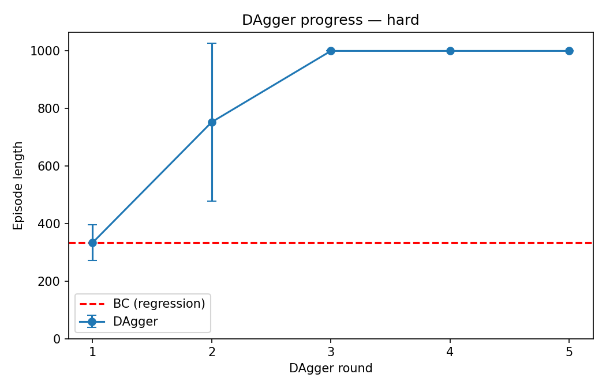
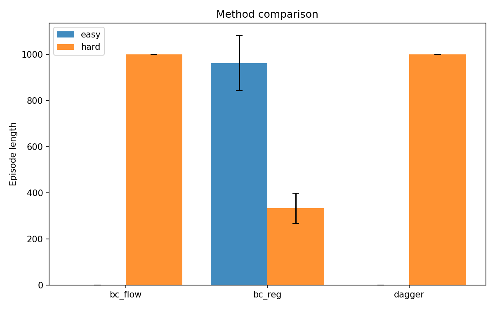

# Homework 1
* Brief [instructions], [colab_instructions] and [installation] for [Homework1].
* For detailed executions, see [run_hw1.ipynb].

## Note
* Implemented algorithms:
  * [x] Behavior Cloning
  * [x] Flow Matching
  * [x] DAgger (Dataset Aggregation)

## Result
* DAgger learning curve  
  
* Comparison
  
* Evaluation rollouts
  * Behavior Cloning - Easy
    | Agent | Expert |
    |:-----:|:------:|
    |||
  * Behavior Cloning - Hard
    | Agent | Expert |
    |:-----:|:------:|
    |||
  * Flow Matching - Hard
    | Agent | Expert |
    |:-----:|:------:|
    |||
  * DAgger - Hard
    | Agent | Expert |
    |:-----:|:------:|
    |||

## Reference

[instructions]: README_.md
[colab_instructions]: colab_instructions.md
[installation]: installation.md
[Homework1]: https://cs224r.stanford.edu/material/hw1/CS224R_2026_Homework_1.pdf
[run_hw1.ipynb]: run_hw1.ipynb
