# Homework 2
* Brief [instructions] for [Homework2].
* For detailed executions, see [run_hw2_p1.ipynb], [run_hw2_p2p3.ipynb] and [run_hw2_modal.ipynb].

## Note
* Implemented algorithms:
  * [x] Tabular Q-Learning
  * [x] Generalized Advantage Estimation (GAE)
  * [x] Proximal Policy Optimization (PPO)
  * [x] Actor-Critic

## Result
* Learning curves  
   
* Evaluation rollouts
  * P2  
    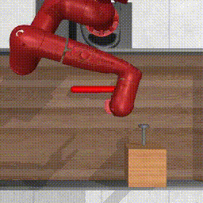 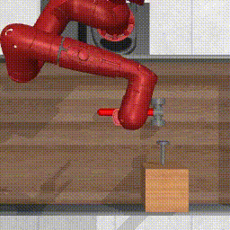 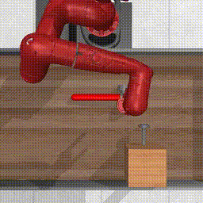 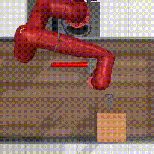 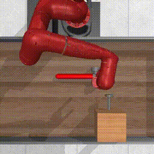
  * P3-1  
    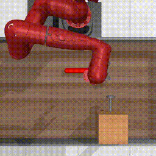 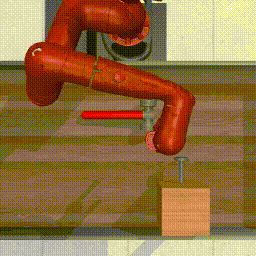 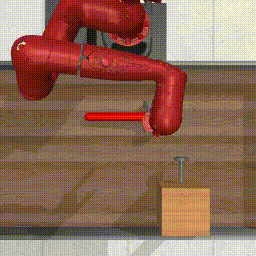 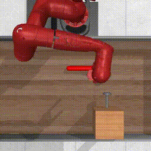 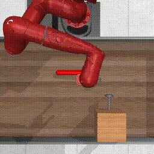
  * P3-2  
    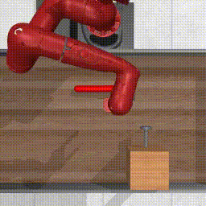 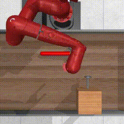 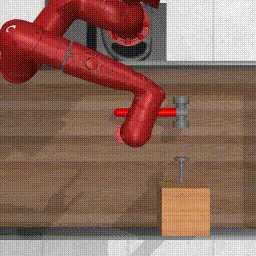 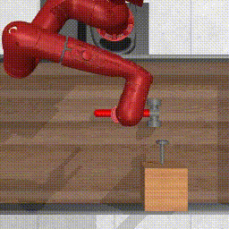 

[instructions]: README_.md
[Homework2]: https://cs224r.stanford.edu/material/hw2/CS224R_2026_Homework_2.pdf
[run_hw2_p1.ipynb]: run_hw2_p1.ipynb
[run_hw2_p2p3.ipynb]: run_hw2_p2p3.ipynb
[run_hw2_modal.ipynb]: run_hw2_modal.ipynb
