# Homework 3
* Brief [instructions] for [Homework3].
* For detailed executions, see [run_hw3.ipynb] and [run_hw3_modal.ipynb].

## Note
* Implemented algorithms:
  * [x] Advantage Weighted Actor Critic (AWAC)
  * [x] Implicit Q-Learning (IQL)
* Adjusted camera angles during evaluation rendering for a clearer view.

## Result
### AntMaze - UMaze
* Learning curves  
  (x-axis: timesteps)  
  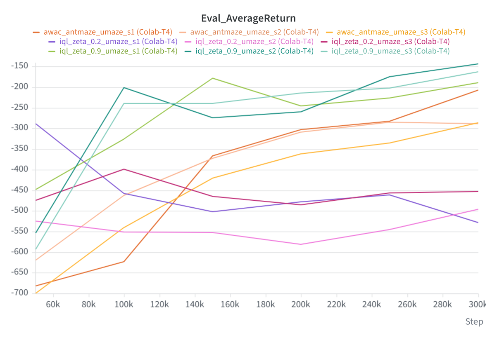 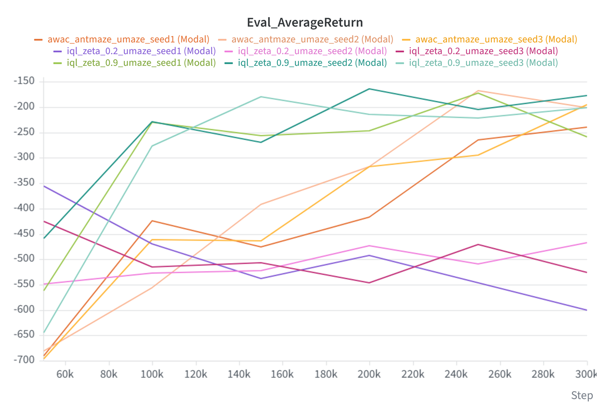
* Evaluation rollouts
  * AWAC  
      
  * IQL, `zeta = 0.2`  
      
  * IQL, `zeta = 0.9`  
      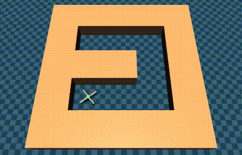

### AntMaze - Medium-Diverse
* Learning curves  
  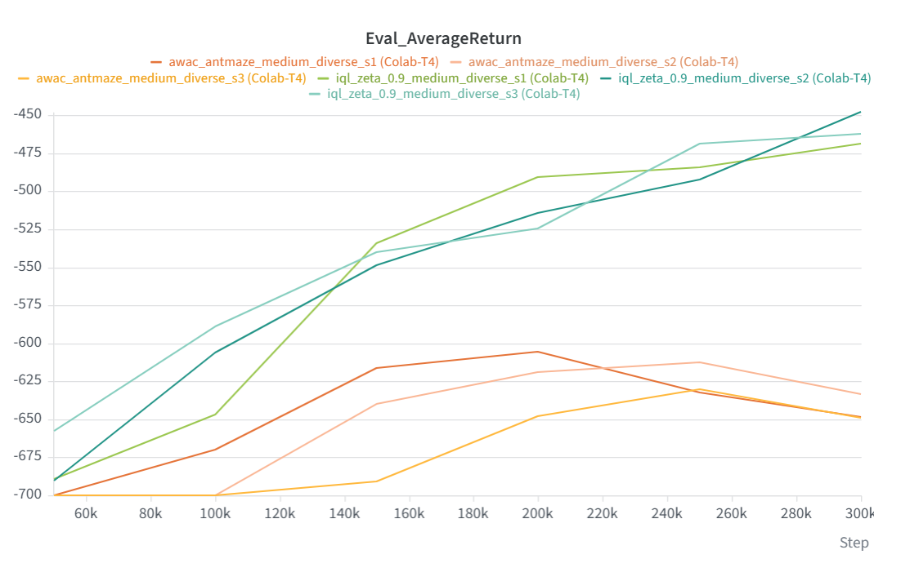 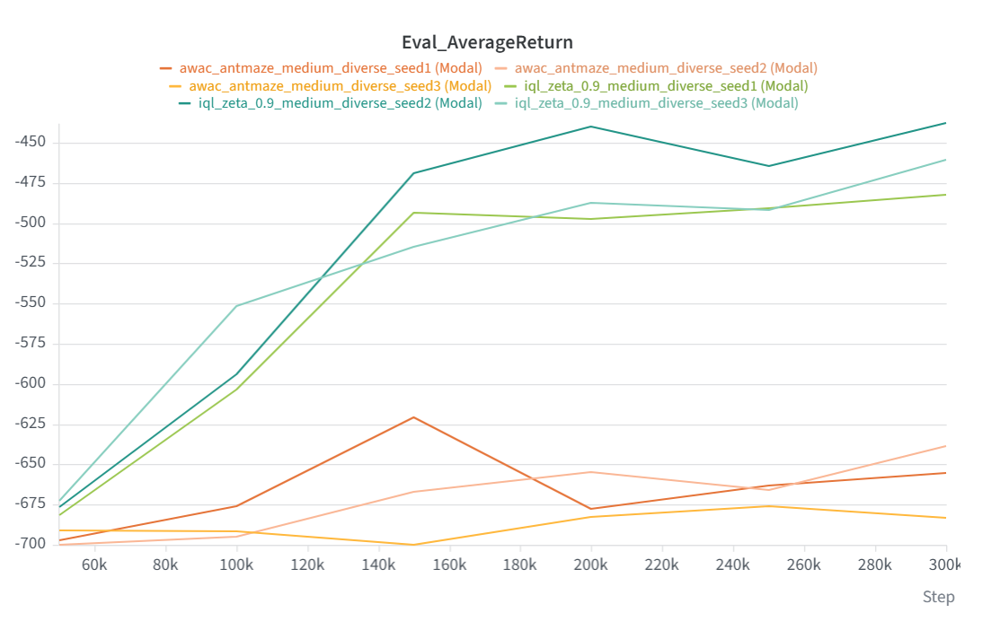
* Evaluation rollouts
  * AWAC  
      
    Note that the ant in the third evaluation video actually fails—it doesn't reach the goal at the top-right corner.
  * IQL, `zeta = 0.9`  
    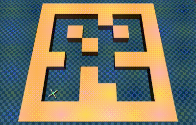  

### PointMass - Medium
* Learning curves  
  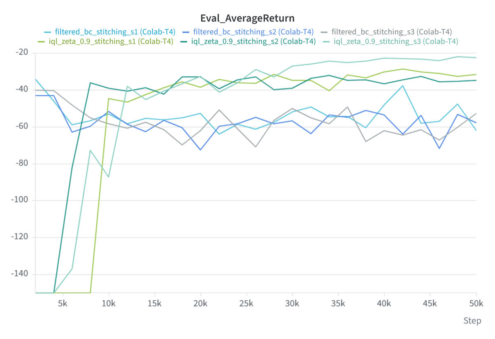 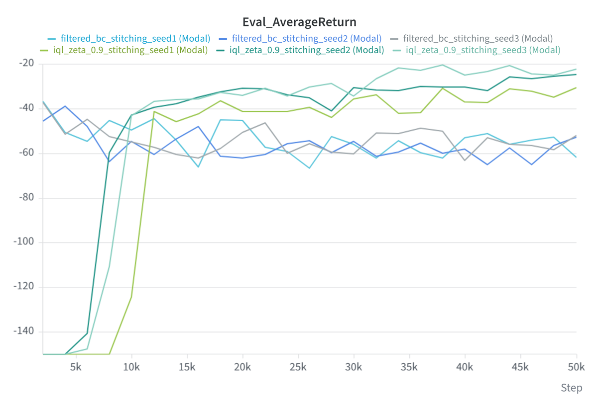
* Evaluation rollouts
  * Filtered BC  
    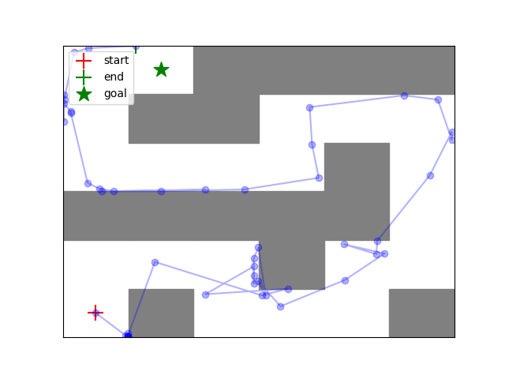 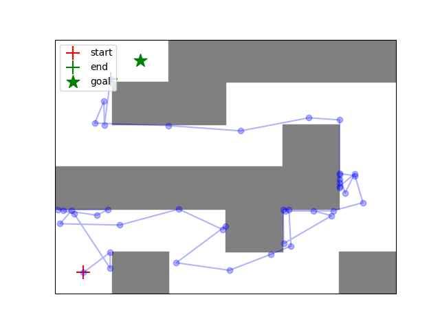 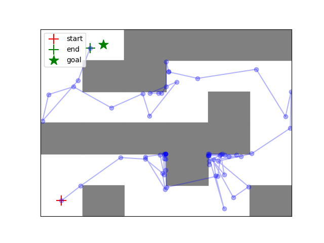
  * IQL, `zeta = 0.9`  
    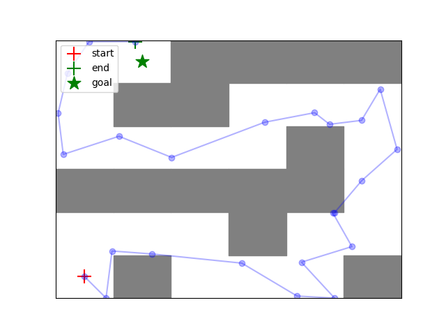 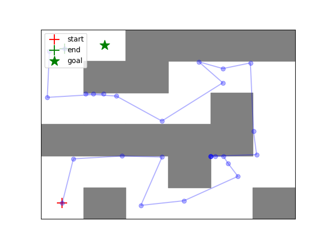 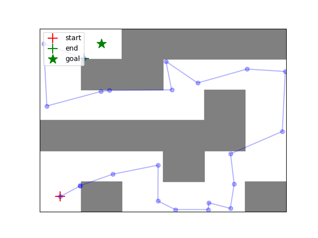

[instructions]: README_.md
[Homework3]: https://cs224r.stanford.edu/material/hw3/CS224R_2026_Homework_3.pdf
[run_hw3.ipynb]: run_hw3.ipynb
[run_hw3_modal.ipynb]: run_hw3_modal.ipynb
